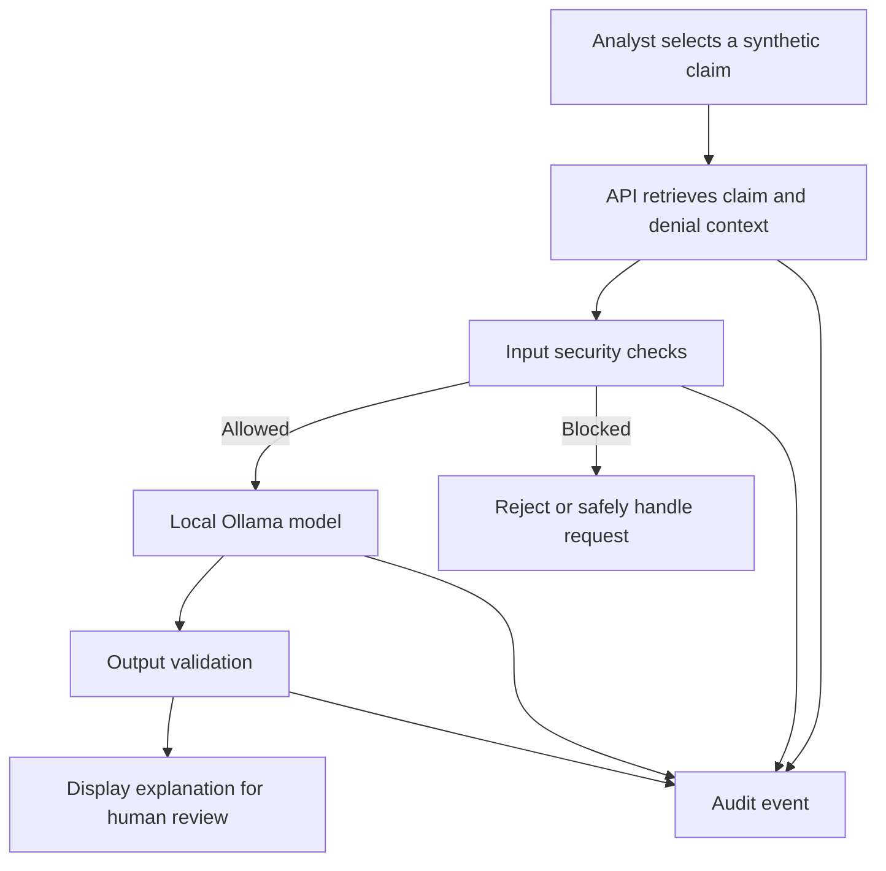
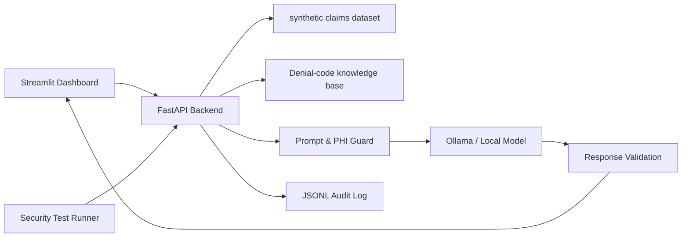
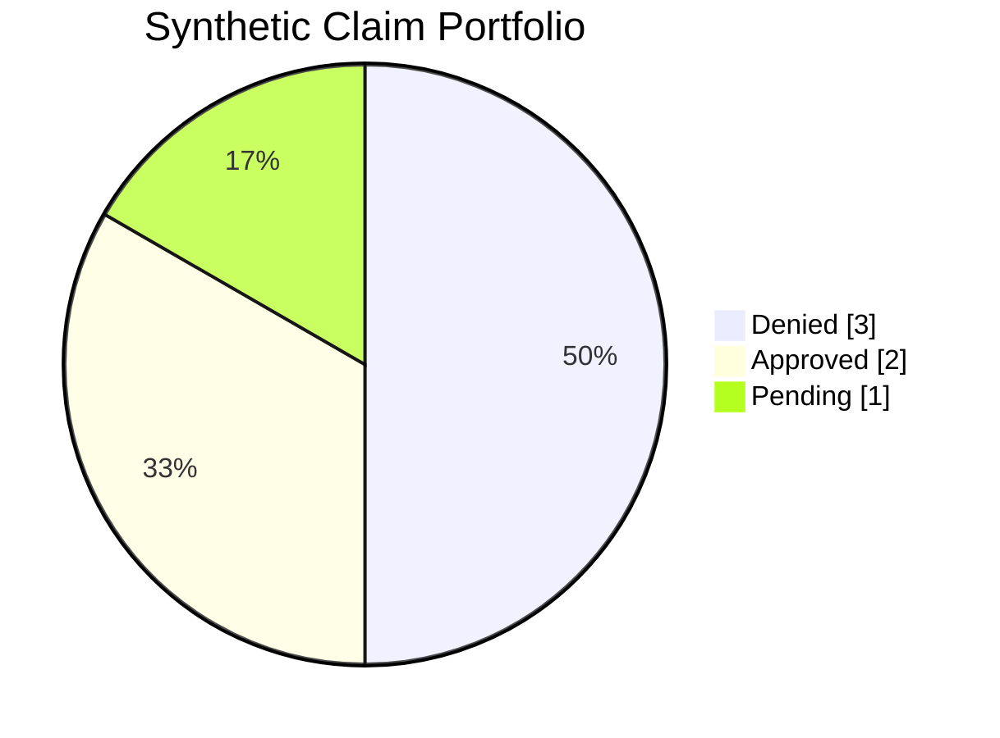
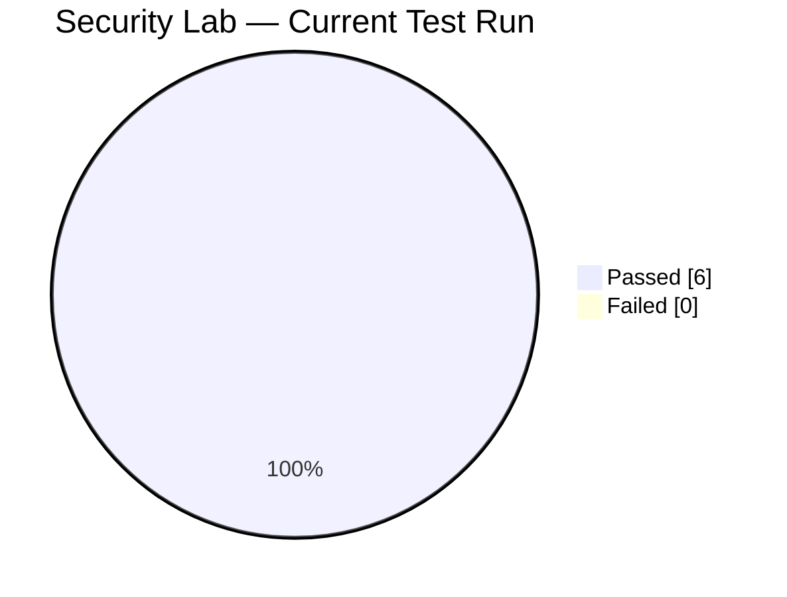

<div align="center">

# SecureAI-RCM
### AI-Assisted Healthcare Claims Denial Intelligence — with Security Guardrails

[](https://www.python.org/)
[](https://fastapi.tiangolo.com/)
[](https://streamlit.io/)
[](https://www.docker.com/)
[](https://github.com/Rajesh2107/SecureAI-RCM)

**A portfolio project exploring how AI can explain healthcare claim denials while keeping privacy, validation, and auditability in the design.**

</div>

---

## Why I built this

Imagine a healthcare claim gets denied. A billing analyst has to understand the reason, find the relevant policy context, and decide what to do next. This project demonstrates how a small, local AI workflow can help explain a denial—without pretending to make the final healthcare or billing decision.

SecureAI-RCM uses **synthetic claim data** and a locally hosted language model. It adds security checks around user input and model output, plus an audit trail and a small security test lab.

> **Important:** This is a learning/demo application. It does not process real patient records, submit claims, or make clinical, coverage, or reimbursement decisions.

## What it demonstrates

| Capability | What it does |
|---|---|
| Synthetic claims register | Shows sample denied, approved, and pending claims |
| Denial explanation | Retrieves denial-code context and asks a local model to explain it |
| Input guardrails | Checks prompts for suspicious instructions and possible sensitive data |
| PHI detection & masking | Demonstrates detection and masking patterns for sample identifiers |
| Output validation | Checks generated explanations for basic quality and grounding |
| Audit trail | Records selected security and application events in JSONL |
| Security lab | Runs a fixed set of defensive test cases and displays results |
| Dashboard | Brings claim, AI explanation, and security/audit views together |

## Workflow



## Architecture



## Claim portfolio (demo dataset)

The repository's sample dataset contains **6 synthetic claims**.



| Status | Count | Meaning in the demo |
|---|---:|---|
| Denied | 3 | Claims available for denial explanation |
| Approved | 2 | Sample approved claims |
| Pending | 1 | Sample claim awaiting a result |
| **Total** | **6** | Synthetic records only |

## Security lab results

The included runner currently has **6 test cases** covering prompt-injection patterns, email/phone/SSN detection, safe prompt handling, and masking.



| Test | Demonstration |
|---|---|
| SEC-001 | Prompt-injection pattern detection |
| SEC-002 | Email-like sensitive data detection |
| SEC-003 | Phone-like sensitive data detection |
| SEC-004 | Safe prompt handling |
| SEC-005 | PHI masking |
| SEC-006 | SSN-like sensitive data detection |

**Result interpretation:** 6/6 tests passed in the current small test suite (100% of these test cases). This is not a penetration test, formal security certification, or proof that the application is secure.

## Security design: defense in depth

| Layer | Purpose | Limitation |
|---|---|---|
| Prompt checks | Identify selected suspicious instruction patterns | Pattern-based; can miss novel attacks |
| Sensitive-data checks | Detect selected email, phone, and SSN patterns | Not a complete PHI/DLP solution |
| Masking | Replace detected values in supported examples | Depends on detector coverage |
| Response validation | Check basic response quality/grounding | Does not guarantee factual correctness |
| Audit logging | Preserve selected events for review | Logs must be protected and monitored |
| Human review | Keeps the analyst responsible for decisions | Human review can still make mistakes |

## Technology stack

| Component | Technology |
|---|---|
| API | Python, FastAPI |
| Dashboard | Streamlit |
| Local inference | Ollama (`qwen3:1.7b` in the configured demo) |
| Data | JSON synthetic claims and denial-code knowledge |
| Security testing | Python test runner / pytest |
| Packaging | Docker, Docker Compose |
| Audit | JSON Lines (`logs/security_audit.jsonl`) |

## Run locally (Windows PowerShell)

### 1. Clone the repository

```powershell
git clone https://github.com/Rajesh2107/SecureAI-RCM.git
cd SecureAI-RCM
```

### 2. Create and activate a virtual environment

```powershell
python -m venv .venv
.\.venv\Scripts\Activate.ps1
```

### 3. Install dependencies

```powershell
pip install -r requirements.txt
```

### 4. Start Ollama

Install Ollama if needed, then pull the configured model:

```powershell
ollama pull qwen3:1.7b
```

Keep Ollama running on the host.

### 5. Start the API

```powershell
uvicorn app.main:app --reload
```

API documentation: http://localhost:8000/docs

### 6. Start the dashboard (in a second PowerShell window)

```powershell
cd C:\Projects\SecureAI-RCM
.\.venv\Scripts\Activate.ps1
streamlit run app/frontend/dashboard.py
```

Dashboard: http://localhost:8501

## Run with Docker Compose

Make sure Docker Desktop is running and Ollama is available on the Windows host.

```powershell
docker compose up --build -d
docker compose ps
```

- Dashboard: http://localhost:8501
- API docs: http://localhost:8000/docs

Stop **only this project's Compose services**:

```powershell
docker compose down
```

> This command is scoped to the Compose project in this directory. Avoid using broad commands such as `docker stop $(docker ps -q)` because other projects may be running.

## Run tests

```powershell
.\.venv\Scripts\Activate.ps1
pytest -v
python run_security_lab.py
```

The security runner is a fixed educational test script. Its results represent only the checks included in the repository.

## Repository map

```text
SecureAI-RCM/
├── app/
│   ├── ai/                 # Local AI explanation workflow
│   ├── audit/              # JSONL audit logging
│   ├── frontend/           # Streamlit dashboard
│   ├── knowledge/          # Denial-code knowledge
│   ├── security/            # Prompt/PHI guardrails and gateway
│   ├── validation/         # Output and denial validation
│   └── main.py             # FastAPI routes
├── datasets/                # Synthetic claims
├── docs/                    # Project documentation
├── logs/                    # Local audit output (do not commit real data)
├── tests/                   # Automated tests
├── Dockerfile
├── Dockerfile.frontend
├── docker-compose.yml
├── run_security_lab.py
└── README.md
```

## Known limitations & next steps

This is intentionally a small learning project. Current limitations include:

- Synthetic data only; no real patient or payer data.
- Pattern-based prompt and sensitive-data detection.
- No enterprise identity, role-based access control, or production secrets management.
- No formal threat-model validation, independent penetration test, or compliance certification.
- Model output can be incomplete or wrong; a human must verify it.
- Local demo configuration is not intended for public or production deployment.

Potential improvements:
- Add authentication and authorization.
- Expand adversarial tests and evaluation datasets.
- Improve retrieval and citations to source policy documents.
- Add structured metrics and monitoring.
- Add deployment hardening and privacy review.

## Author

**Rajesh Chavan** — Cybersecurity | AI Security | Security Engineering

GitHub: [@Rajesh2107](https://github.com/Rajesh2107)

---

<sub>Built for learning and portfolio demonstration. Synthetic data only. Not medical, legal, payer, or reimbursement advice.</sub>
